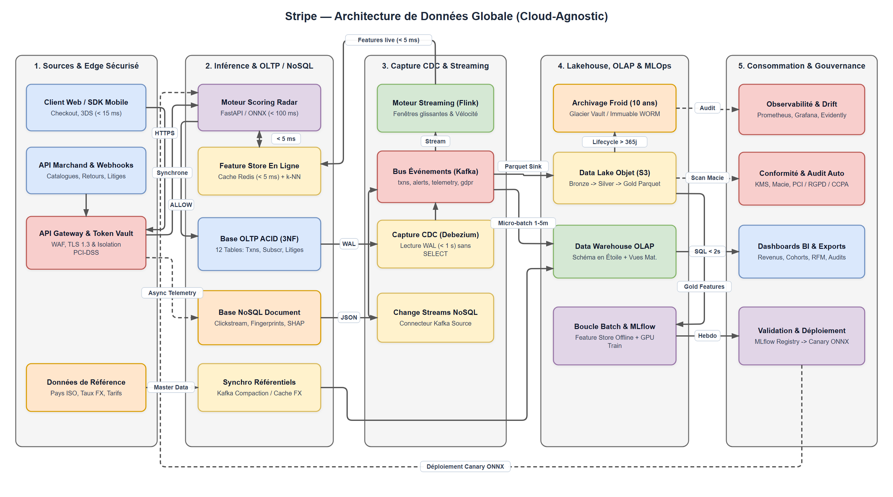
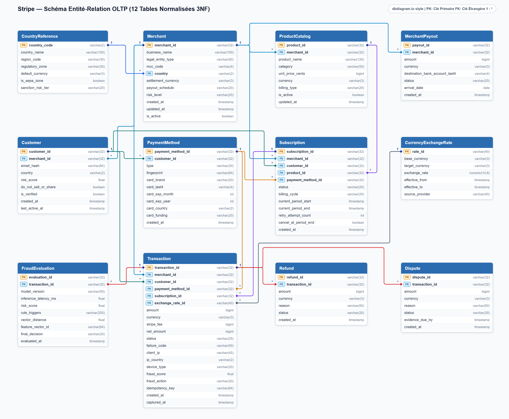
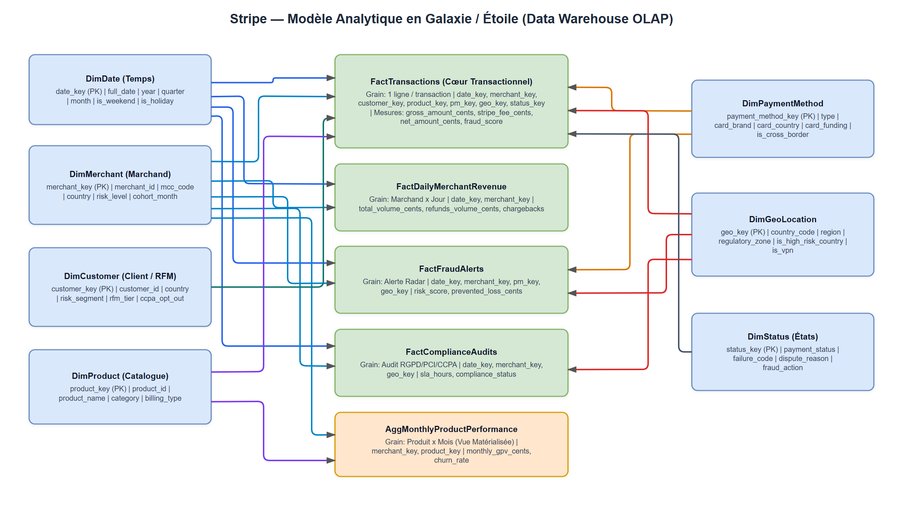
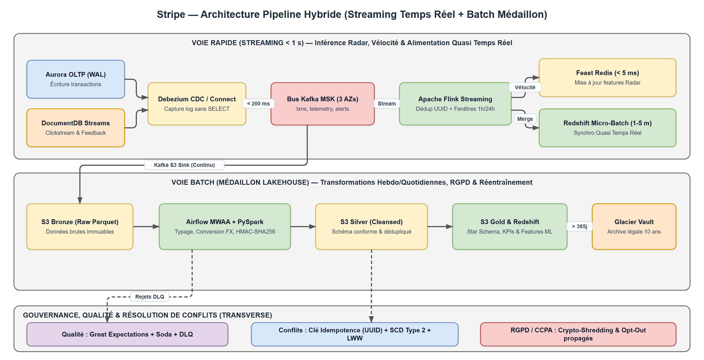
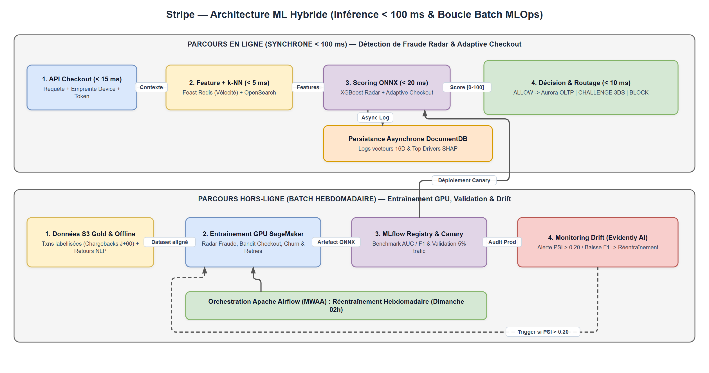

# 🧾 Stripe – Architecture Complète de Données (Bloc 2)

> Architecture complète de données (OLTP, OLAP, NoSQL, Pipelines, Sécurité, ML) conçue pour répondre aux besoins transactionnels, analytiques et temps réel de Stripe.

---

## 🟩 1. Contexte général

Stripe traite chaque jour plusieurs millions de paiements en ligne pour des marchands du monde entier.
Pour fonctionner sans panne tout en pilotant l'activité et la fraude en temps réel, son architecture repose sur **trois besoins complémentaires** :

1. Enregistrer chaque paiement avec une **fiabilité absolue (ACID)** et zéro perte d'argent via un modèle **OLTP**.
2. Analyser les volumes, commissions, litiges et cohortes sans ralentir la production grâce à un modèle **OLAP**.
3. Absorber les traces techniques, données hétérogènes et signaux fraude en temps réel via une base **NoSQL** et du **Machine Learning**.

### Vue d'ensemble de l'architecture cible



> Source éditable : [`diagrams/drawio/01_architecture_globale.drawio`](diagrams/drawio/01_architecture_globale.drawio) · Vue AWS : [`diagrams/png/01b_architecture_aws_physique.png`](diagrams/png/01b_architecture_aws_physique.png)

Lecture du schéma, de gauche à droite :

1. Les **sources** (Checkout web/mobile, APIs marchands, webhooks) passent par la sécurité Edge (tokenisation carte).
2. L'**OLTP PostgreSQL (Aurora)** enregistre les paiements, abonnements et remboursements (ACID).
3. L'**ingestion** combine streaming/CDC (`Debezium` + `Kafka`) et traitements batch (`Airflow` + `dbt`).
4. Le **stockage** sépare l'entrepôt **OLAP** (schéma en étoile), le **NoSQL** (`MongoDB / DocumentDB`) et le **Data Lake** (`S3`).
5. La **consommation** : tableaux de bord BI, scoring fraude temps réel (`< 100 ms`), réentraînement ML et audits conformité.

---

## 🟨 2. OLTP – Modèle transactionnel

Le modèle OLTP est **normalisé jusqu'à la 3e forme normale (3NF)** pour éviter les doublons et garantir l'intégrité de chaque euro encaissé.

| Table | Description | Points clés |
| :--- | :--- | :--- |
| `Merchant` | Comptes des marchands Stripe | Code secteur `mcc_code`, pays, devise |
| `Customer` | Clients finaux pseudonymisés | `email_hash` SHA-256, opt-out CCPA |
| `PaymentMethod` | Moyens de paiement tokenisés | Zéro numéro de carte (PAN), 4 derniers chiffres |
| `Transaction` | Table centrale des paiements | Montants en centimes, `idempotency_key` unique |
| `Subscription` | Abonnements récurrents | Cycle facturation, statut, nombre de relances |
| `ProductCatalog` | Catalogue produits et forfaits | Tarif unitaire, récurrent ou ponctuel |
| `Refund` / `Dispute` | Remboursements et litiges bancaires | Rattachés à `Transaction` |
| `MerchantPayout` | Virements vers les marchands | Suivi du solde versé et statut |
| `FraudEvaluation` | Trace de la décision fraude | Score temps réel, latence, version modèle |
| `CountryReference` / `CurrencyExchangeRate` | Données de référence | Zones légales (RGPD/CCPA) et taux de change |

### ERD complet OLTP (3NF)



> Source DBML importable dans `dbdiagram.io` : [`sql/stripe_oltp.dbml`](sql/stripe_oltp.dbml) · DDL PostgreSQL : [`sql/stripe_oltp_olap.sql`](sql/stripe_oltp_olap.sql)

**Justification :**

- Les **clés primaires/étrangères** et `idempotency_key` empêchent tout double débit ou donnée orpheline.
- Les montants sont stockés en **entiers (`BIGINT` centimes)** pour éviter toute erreur d'arrondi.
- Le **grain** du modèle est la **transaction unitaire** : un paiement, un remboursement ou un virement.

---

## 🟦 3. OLAP – Modèle analytique

Le modèle analytique utilise un **schéma en étoile (Star Schema)** sur Data Warehouse pour accélérer les agrégations BI sans toucher à l'OLTP.



> Vue complète avec toutes les colonnes et types : [`stripe_olap_schema.png`](stripe_olap_schema.png) · Source DBML : [`sql/stripe_olap.dbml`](sql/stripe_olap.dbml)

### 🔹 Tables de dimensions

| Table | Rôle | Exemples de colonnes |
| :--- | :--- | :--- |
| `DimMerchant` | Profil des marchands | nom, secteur MCC, pays, niveau de risque |
| `DimCustomer` | Profil et valeur client | segment RFM, segment risque, opt-out CCPA |
| `DimProduct` | Offres et abonnements | catégorie, `one_time` ou `recurring` |
| `DimDate` | Découpage temporel | jour, semaine, mois, trimestre, année |
| `DimPaymentMethod` | Type de moyen de paiement | carte/SEPA, réseau Visa/MC, `is_cross_border` |
| `DimGeoLocation` | Localisation et conformité | code pays, ville, zone légale (`RGPD_EEA`, `CCPA_US`) |
| `DimStatus` | Statuts et motifs | `succeeded`/`failed`, motif refus, action fraude |

### 🔸 Tables de faits

| Table | Grain | Mesures | Axes d'analyse |
| :--- | :--- | :--- | :--- |
| `FactTransactions` | 1 ligne = 1 paiement unitaire | montant brut, frais Stripe, net, score fraude | revenus, marges, refus |
| `FactDailyMerchantRevenue` | 1 ligne = 1 marchand / jour | volume du jour, nb succès/échecs, chargebacks | tableaux de bord marchands |
| `FactFraudAlerts` | 1 ligne = 1 alerte fraude Radar | montant bloqué, score risque, faux positif | efficacité IA, pertes évitées |

**KPI typiques :**

- **Volume d'affaires brut (GPV)** et marge nette Stripe par marchand et par mois.
- **Taux de refus** par moyen de paiement et pays émetteur.
- **Taux de chargebacks (litiges)** comparé au seuil d'alerte Visa/Mastercard (`1 %`).
- **Pertes évitées par l'IA** (`SUM(prevented_loss_cents)`).

**Justification :**

- Le **Star Schema** évite les cascades de jointures et simplifie l'écriture des requêtes BI.
- Les **clés de substitution entières** rendent les jointures rapides entre faits et dimensions.
- Le **grain** de chaque table de faits est explicite, évitant tout double comptage.

---

## 🟧 4. NoSQL – Données semi-structurées

Certaines données Stripe ont une structure variable ou arrivent en très haut débit (empreintes appareils, parcours Checkout, retours clients, logs). Elles sont stockées dans une base documentaire **MongoDB / Amazon DocumentDB**.

### 🔹 Exemple : empreinte d'appareil et vélocité (`device_fingerprints`)

```json
{
  "_id": "fp_982a7b8c",
  "fingerprint_hash": "e3b0c44298fc...",
  "customer_id": "cus_9s8f72aK",
  "last_seen": "2026-11-12T20:15:30Z",
  "hardware": {
    "device_type": "desktop_web",
    "screen": "2560x1440",
    "is_headless": false
  },
  "velocity_metrics": {
    "cards_associated_count": 2,
    "merchants_visited_24h": 4,
    "txns_attempted_1h": 1
  }
}
```

### 🔹 Exemple : retour client enrichi (`customer_feedback`)

```json
{
  "_id": "fbk_7741a2b9",
  "merchant_id": "acct_1H2X92",
  "customer_id": "cus_9s8f72aK",
  "created_at": "2026-11-12T18:10:00Z",
  "nps_score": 4,
  "raw_comment": "Trop de refus 3D-Secure sur mobile lors du renouvellement.",
  "nlp_enrichment": {
    "sentiment_score": -0.68,
    "detected_topics": ["3ds_friction", "mobile_checkout"],
    "churn_risk_signal": "high"
  }
}
```

### 🔸 Choix techniques

- **Embedding (imbrication)** pour les sous-documents courts consultés en bloc (`hardware`, `velocity_metrics`, `nlp_enrichment`, tentatives de webhooks).
- **Referencing (référence par ID)** pour relier au monde SQL sans dupliquer (`merchant_id`, `customer_id`, `transaction_id`).
- **Indexation** : `{ fingerprint_hash: 1 }` (accès direct temps réel), `{ merchant_id: 1, timestamp: -1 }` (historique par marchand) et index **TTL 90 jours** sur les logs.

---

## 🟥 5. Pipeline de données

Le pipeline relie l'OLTP, l'OLAP et le NoSQL en séparant trois zones claires : **staging (S3 Bronze) → warehouse (S3 Silver / Redshift) → analytics (Gold / BI)**.



> Source éditable : [`diagrams/drawio/02_pipeline_etl.drawio`](diagrams/drawio/02_pipeline_etl.drawio)

### Étapes principales

| Étape | Description | Outils suggérés |
| :--- | :--- | :--- |
| **Extract** | Lecture du journal WAL PostgreSQL et flux NoSQL sans bloquer la prod | Debezium CDC, Mongo Connector |
| **Streaming** | Transport temps réel vers le cache ML et le Data Lake | Apache Kafka (MSK), Apache Flink |
| **Transform** | Nettoyage, contrôle qualité, conversion devises et agrégations | dbt, PySpark, Great Expectations |
| **Load** | Chargement dans le Star Schema et le Data Lake Parquet | Redshift, Amazon S3 |
| **Orchestration** | Planification et suivi automatique des traitements batch | Apache Airflow |

**Points forts :**

- **Zéro impact sur l'OLTP** : Debezium lit le journal interne (WAL) plutôt que d'exécuter de lourdes requêtes `SELECT`.
- **Séparation nette** entre la zone brute (staging S3) et les tables analytiques (warehouse).
- **Idempotence** : les chargements (`MERGE`) utilisent le numéro d'ordre de Postgres et le statut du paiement pour supporter les rejeux Kafka sans doublons.
- **Analyses hybrides** : croisement des transactions OLAP avec la télémétrie NoSQL (parcours Checkout, logs, avis).

---

## 🟪 6. Sécurité & conformité

### 🔐 Sécurité des données

| Risque | Mesure de protection | Responsable |
| :--- | :--- | :--- |
| Fuite de données bancaires (cartes) | Coffre-fort de tokenisation isolé (zéro numéro de carte en base) | CISO |
| Interception / fuite en base | Chiffrement AES-256 (KMS) au repos + TLS 1.3 en transit | Admin système / SecOps |
| Accès non autorisé | Contrôle d'accès par rôle (RBAC) et principe du moindre privilège | Lead Sécurité Cloud |
| Perte de données | Sauvegardes continues + réplication Multi-AZ (RPO = 0) | Admin BDD |
| Audit et fraude interne | Logs d'audit centralisés (CloudTrail) et détection PII automatisée (Macie) | Responsable Conformité |

### 🧾 Conformité PCI-DSS, RGPD & CCPA

- **Tokenisation PCI-DSS** : les numéros de carte (PAN/CVV) restent hors des bases Data ; seuls un token et les 4 derniers chiffres circulent.
- **Souveraineté & minimisation** : hébergement UE à Paris (`eu-west-3`), emails hachés en SHA-256.
- **Droit à l'oubli (RGPD Art. 17)** : anonymisation du profil client à la demande tout en gardant les écritures comptables anonymisées (obligation légale 10 ans).
- **Opt-Out CCPA** : drapeau `do_not_sell_or_share` excluant automatiquement le profil des modèles marketing et exports BI.

> **Note FinOps & GreenOps :** Budget cible ~25 000 $/mois (dimensionné pour 15M txns/jour en Multi-AZ), optimisé par **Savings Plans** (`-38 %` sur Aurora), instances **GPU Spot éphémères** (`-70 %` sur l'entraînement ML), archivage **S3 Glacier** et choix de la région **Paris bas-carbone**.

---

## 🟫 7. Intégration Machine Learning (aperçu)

L'architecture alimente trois cas d'usage IA à partir des données historiques (OLAP/S3) et temps réel (NoSQL/Kafka).

| Cas d'usage | Données utilisées | Type de modèle |
| :--- | :--- | :--- |
| **Détection de fraude (Radar < 100 ms)** | Vélocité carte + empreinte appareil + historique | Classification (XGBoost / ONNX) |
| **Personnalisation (Adaptive Checkout)** | Parcours clickstream NoSQL + appareil + pays | Bandit contextuel / Ranking |
| **Prédictif (Smart Retries & Churn)** | Historique échecs + logs webhooks + avis NLP | Classification / Série temporelle |

### Pipeline ML



> Source éditable : [`diagrams/drawio/08_ml_pipeline.drawio`](diagrams/drawio/08_ml_pipeline.drawio)

### Données utilisées :

- **Historique labellisé (OLAP / Data Lake S3)** : transactions passées, litiges et renouvellements d'abonnements.
- **Signaux temps réel (NoSQL / Feature Store Redis)** : télémétrie d'appareil, vitesse de saisie, compteurs 1h/24h.
- **Contexte marchand et client** : secteur d'activité, pays, ancienneté (`DimMerchant`, `DimCustomer`).

**💡 Exemples d'applications :**

- Bloquer ou déclencher un 3D-Secure en moins de 100 ms avant l'autorisation bancaire.
- Afficher en premier Apple Pay, Carte ou SEPA selon l'appareil et les habitudes du client.
- Relancer un abonnement échoué au moment où il a le plus de chances de passer.

---

## 🟪 8. SQL et NoSQL – Requêtes d'analyse

### 🔹 Exemples de requêtes SQL (OLAP)

#### 1️⃣ Top 10 des marchands par volume d'affaires et marge Stripe

```sql
SELECT
    m.merchant_id,
    m.business_name,
    d.month_name,
    ROUND(SUM(f.gross_amount_cents) / 100.0, 2) AS total_volume_eur,
    ROUND(SUM(f.stripe_fee_cents) / 100.0, 2) AS total_fees_eur,
    COUNT(f.fact_txn_key) AS total_txns
FROM FactTransactions f
JOIN DimMerchant m ON f.merchant_key = m.merchant_key
JOIN DimDate d ON f.date_key = d.date_key
JOIN DimStatus s ON f.status_key = s.status_key
WHERE s.payment_status = 'succeeded' AND d.year = 2026
GROUP BY m.merchant_id, m.business_name, d.month_name
ORDER BY total_volume_eur DESC
LIMIT 10;
```

```text
Question métier : quels marchands génèrent le plus de chiffre d'affaires et de commissions ?
Résultat attendu : classement des 10 premiers marchands avec volume encaissé, commissions Stripe et nombre de paiements.
```

#### 2️⃣ Détection des marchands au-dessus du seuil d'alerte de litiges (1 %)

```sql
SELECT
    m.merchant_id,
    m.business_name,
    COUNT(f.fact_txn_key) AS total_txns,
    SUM(f.is_disputed) AS total_disputes,
    ROUND(100.0 * SUM(f.is_disputed) / COUNT(f.fact_txn_key), 2) AS chargeback_rate_pct
FROM FactTransactions f
JOIN DimMerchant m ON f.merchant_key = m.merchant_key
JOIN DimDate d ON f.date_key = d.date_key
WHERE d.full_date >= CURRENT_DATE - INTERVAL '30 days'
GROUP BY m.merchant_id, m.business_name
HAVING COUNT(f.fact_txn_key) >= 500
   AND (100.0 * SUM(f.is_disputed) / COUNT(f.fact_txn_key)) >= 0.75
ORDER BY chargeback_rate_pct DESC;
```

```text
Question métier : quels marchands approchent le seuil de sanction Visa/Mastercard de 1 % de chargebacks ?
Résultat attendu : liste des marchands à risque sur les 30 derniers jours triée par taux de contestation décroissant.
```

#### 3️⃣ Part des revenus récurrents (abonnements) par catégorie produit

```sql
SELECT
    p.category,
    p.billing_type,
    COUNT(f.fact_txn_key) AS nb_txns,
    ROUND(SUM(f.gross_amount_cents) / 100.0, 2) AS total_gpv_eur
FROM FactTransactions f
JOIN DimProduct p ON f.product_key = p.product_key
JOIN DimStatus s ON f.status_key = s.status_key
WHERE s.payment_status = 'succeeded'
GROUP BY p.category, p.billing_type
ORDER BY total_gpv_eur DESC;
```

```text
Question métier : quel est le poids des abonnements par rapport aux achats unitaires ?
Résultat attendu : comparaison du volume d'affaires et du nombre de transactions entre recurring et one_time par catégorie.
```

---

### 🔸 Exemples de requêtes NoSQL (MongoDB / DocumentDB)

#### 1️⃣ Détection d'attaques par vélocité sur un même terminal

```js
db.device_fingerprints.aggregate([
  { $match: { "velocity_metrics.cards_associated_count": { $gte: 3 } } },
  {
    $project: {
      fingerprint_hash: 1,
      customer_id: 1,
      cards_tested: "$velocity_metrics.cards_associated_count",
      merchants_hit: "$velocity_metrics.merchants_visited_24h"
    }
  },
  { $sort: { cards_tested: -1 } },
  { $limit: 20 }
]);
```

```text
Question métier : quels appareils ont testé au moins 3 cartes différentes récemment ?
Résultat attendu : liste des 20 terminaux les plus suspects classés par nombre de cartes testées.
```

#### 2️⃣ Suivi des échecs de webhooks par marchand

```js
db.webhook_delivery_logs.aggregate([
  { $match: { delivery_status: { $ne: "succeeded" } } },
  {
    $group: {
      _id: { merchant_id: "$merchant_id", endpoint: "$endpoint_url" },
      failed_count: { $sum: 1 }
    }
  },
  { $match: { failed_count: { $gte: 5 } } },
  { $sort: { failed_count: -1 } }
]);
```

```text
Question métier : quels marchands rencontrent un pic d'erreurs sur leurs webhooks ?
Résultat attendu : liste des marchands et URLs cumulant au moins 5 échecs de livraison.
```

#### 3️⃣ Analyse des motifs d'insatisfaction client (signaux de churn)

```js
db.customer_feedback.aggregate([
  { $match: { "nlp_enrichment.sentiment_score": { $lt: -0.25 } } },
  { $unwind: "$nlp_enrichment.detected_topics" },
  {
    $group: {
      _id: "$nlp_enrichment.detected_topics",
      complaints_count: { $sum: 1 },
      avg_nps: { $avg: "$nps_score" }
    }
  },
  { $sort: { complaints_count: -1 } }
]);
```

```text
Question métier : quels problèmes récurrents génèrent le plus d'avis négatifs et de départs clients ?
Résultat attendu : classement des thèmes d'irritation par volume de plaintes avec score NPS moyen.
```

---

## 🧠 9. Résumé global

| Système | Objectif | Type de données | Exemple |
| :--- | :--- | :--- | :--- |
| **OLTP** | Enregistrer paiements, abonnements et virements (ACID) | Structurées (3NF) | Aurora PostgreSQL |
| **OLAP** | Calculer KPIs financiers, marges et risques | Agrégées (Star Schema) | Redshift / Warehouse |
| **NoSQL** | Capturer télémétrie, avis NLP, logs et vecteurs ML | Semi-structurées (JSON) | MongoDB / DocumentDB |

---

## 🧩 10. Diagrammes du dépôt

| Fichier | Contenu |
| :--- | :--- |
| [`diagrams/png/01_architecture_globale.png`](diagrams/png/01_architecture_globale.png) | Architecture logique complète (sources → OLTP → CDC/pipeline → OLAP/NoSQL → usages) |
| [`diagrams/png/01b_architecture_aws_physique.png`](diagrams/png/01b_architecture_aws_physique.png) | Déploiement physique AWS Multi-AZ (région Paris `eu-west-3`) |
| [`diagrams/png/02_pipeline_etl.png`](diagrams/png/02_pipeline_etl.png) | Pipeline détaillé streaming (CDC/Kafka) + batch (Airflow/dbt/S3) |
| [`diagrams/png/03_star_schema.png`](diagrams/png/03_star_schema.png) | Schéma en étoile `FactTransactions` |
| [`diagrams/png/04_oltp_olap_nosql.png`](diagrams/png/04_oltp_olap_nosql.png) | Articulation des 3 stockages (OLTP / OLAP / NoSQL) |
| [`diagrams/png/08_ml_pipeline.png`](diagrams/png/08_ml_pipeline.png) | Chaîne ML : Feature Store Redis → entraînement → registry → monitoring |
| [`stripe_oltp_erd.png`](stripe_oltp_erd.png) | ERD complet OLTP 3NF (`dbdiagram.io` / [`sql/stripe_oltp.dbml`](sql/stripe_oltp.dbml)) |
| [`stripe_olap_schema.png`](stripe_olap_schema.png) | Schéma complet OLAP (`dbdiagram.io` / [`sql/stripe_olap.dbml`](sql/stripe_olap.dbml)) |

---

## 🏁 11. Conclusion

L'architecture Stripe proposée combine les trois piliers essentiels d'une plateforme data moderne :

- Un **OLTP robuste et normalisé (3NF / ACID)** pour ne jamais perdre ou doubler une transaction.
- Un **pipeline unifié (Debezium CDC, Kafka, Airflow)** qui transfère les données sans impacter la production.
- Un **OLAP en étoile** et un **NoSQL documentaire** permettant de piloter la performance financière, la conformité (**PCI-DSS / RGPD / CCPA**) et les modèles d'IA temps réel (**Radar < 100 ms**, **Adaptive Checkout**, **Smart Retries**).

---

## 📎 Annexe technique

### 🔹 Extrait SQL simplifié (OLTP)

```sql
CREATE TABLE oltp.Transaction (
  transaction_id VARCHAR(32) PRIMARY KEY,
  merchant_id VARCHAR(32) REFERENCES oltp.Merchant(merchant_id),
  customer_id VARCHAR(32) REFERENCES oltp.Customer(customer_id),
  payment_method_id VARCHAR(32) REFERENCES oltp.PaymentMethod(payment_method_id),
  amount BIGINT NOT NULL,
  currency VARCHAR(3) NOT NULL,
  status VARCHAR(25) NOT NULL,
  idempotency_key VARCHAR(64) UNIQUE
);
```

### 🔹 Extrait SQL simplifié (OLAP)

```sql
CREATE TABLE olap.FactTransactions (
  fact_txn_key BIGINT PRIMARY KEY,
  date_key INT REFERENCES olap.DimDate(date_key),
  merchant_key INT REFERENCES olap.DimMerchant(merchant_key),
  customer_key INT REFERENCES olap.DimCustomer(customer_key),
  gross_amount_cents BIGINT NOT NULL,
  stripe_fee_cents BIGINT NOT NULL,
  is_disputed INT DEFAULT 0
);
```

### 🔹 Exemple NoSQL simplifié (`clickstream_events`)

```json
{
  "checkout_session_id": "cs_live_a1b2c3",
  "merchant_id": "acct_1H2X92",
  "timestamp": "2026-11-12T20:14:50Z",
  "cvv_typing_duration_ms": 620,
  "chosen_payment_method": "apple_pay",
  "behavioral_bot_score": 0.04
}
```
