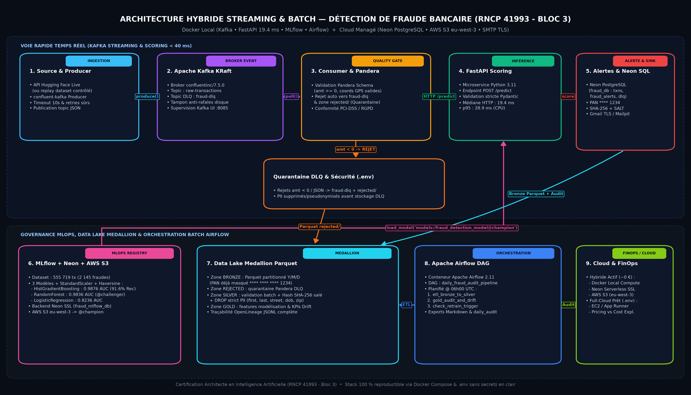

# 🛡️ RAPPORT D'ARCHITECTURE TECHNIQUE — PIPELINE DÉTECTION DE FRAUDE BANCAIRE (RNCP 41993 - BLOC 3)

*Architecture Hybride Docker Local (`Kafka KRaft`, `FastAPI`, `MLflow`, `Apache Airflow`) & Cloud Managé (`Neon PostgreSQL`, `AWS S3 eu-west-3`, `OpenLineage`)*

---

## 1. Contexte, Objectifs & Exigences Métier

Dans le secteur des paiements électroniques, la validation d'une transaction doit intervenir en **moins de 100 ms** tout en assurant une gouvernance analytique quotidienne des flux, le respect strict des réglementations **PCI-DSS** et **RGPD**, et la tolérance aux pannes (données corrompues, pics de trafic).

| Exigence Certification RNCP 41993 | Solution Déployée & Vérifiée |
| :--- | :--- |
| **Streaming Faible Latence (`C2`, `C3`)** | **Apache Kafka KRaft (`confluentinc/cp-kafka:7.5.0`)** + Producteur/Consommateur `confluent-kafka` + Microservice **FastAPI** (`19.4 ms` médiane, `28.9 ms` p95). |
| **Gouvernance MLOps (`C1`, `C4`)** | Serveur **MLflow** dockerisé (backend **Neon `fraud_mlflow_db`** + artefacts réels **AWS S3 `eu-west-3`**), benchmark 3 modèles sur `555 719` transactions, alias **`@champion`** et **`@challenger`**. |
| **Qualité des Données & Quarantaine (`C4`, `C5`)** | Schéma strict **Pandera `DataFrameSchema`** bloquant montants négatifs et anomalies GPS vers topic `fraud-dlq`, table **Neon `dead_letter_queue`** et zone Parquet `rejected/`. |
| **Sécurité PCI-DSS & RGPD** | Masquage PAN `**** **** **** 1234`, hachage irréversible **SHA-256 salé** via `SECRET_SALT` (`.env`), suppression stricte des PII directs (`first`, `last`, `street`, `dob`, `job`, `zip`) en ETL Bronze → Silver et en DLQ. |
| **Alerting & Réconciliation Batch (`C4`, `C5`)** | Envoi e-mail réel par **`smtplib`** (**Mailpit** local ou **Gmail TLS `587`**), persistance **Neon PostgreSQL (`fraud_db`)**, Data Lake Parquet Medallion, événements **OpenLineage** et DAG **Apache Airflow 2.11**. |

---

## 2. Schéma d'Architecture Déployée

---

## 3. Infrastructure Hybride (Docker Compose Local + Neon & AWS S3 Cloud)

L'architecture s'exécute via un orchestrateur unique [`docker-compose.yml`](../../docker-compose.yml) couplé à **Neon Serverless PostgreSQL** et **Amazon S3 (`eu-west-3`)** selon le pattern de déploiement hybride recommandé :

1. **Neon PostgreSQL (Cloud Serverless SSL `eu-central-1`) :** Héberge les bases isolées **`fraud_db`** (tables `transactions`, `fraud_alerts`, `dead_letter_queue`, `daily_audit_summary`) et **`fraud_mlflow_db`** (expérimentations & Model Registry MLflow).
2. **Amazon S3 (`eu-west-3` — bucket `fraud-bloc3-mlflow-rncp41993-chris`) :** Stockage objet réel des modèles MLflow et artefacts d'entraînement (`21` objets enregistrés pour les 3 versions). *(Un service `minio` reste présent en secours local hors-ligne.)*
3. **`mlflow` (`elkristobal59/mlflow:latest`, port `5000`) :** Serveur MLflow local raccordé au backend **Neon `fraud_mlflow_db`** et au stockage objet **AWS S3**.
4. **`kafka` (`confluentinc/cp-kafka:7.5.0`, port `9092`) + `kafka-ui` (port `8085`) :** Bus événementiel KRaft transportant `raw-transactions` et `fraud-dlq`.
5. **`mailpit` (`axllent/mailpit:latest`, ports `1025` SMTP / `8025` Web UI) :** Serveur SMTP local par défaut en démonstration Docker (remplacé à chaud par **Gmail TLS `smtp.gmail.com:587`** via `.env`).
6. **`fraud-scoring-api` (`02_api/Dockerfile`, port `8080`) :** API FastAPI + Pydantic v2 chargeant `models:/fraud_detection_model@champion` depuis MLflow + AWS S3 et rechargée à chaud via `POST /reload-model`.
7. **`airflow` (`04_batch_airflow/Dockerfile` sur `apache/airflow:2.11.0`, port `8088`) :** Ordonnanceur LocalExecutor (métabase locale dédiée sur `postgres:5432/airflow_db`) pilotant le DAG matinal `daily_fraud_audit_pipeline` vers **Neon `fraud_db`**.

---

## 4. Pipeline Machine Learning, Feature Engineering & Benchmark

Toutes les étapes d'entraînement, d'API temps réel et d'ETL Silver appellent une unique fonction partagée [`prepare_features()`](../../01_train/features.py) évitant tout *training-serving skew* :

* **Variables extraites (`5 features`) :** `amt` (montant), `distance_km` (distance orthodromique de Haversine porteur–marchand), `city_pop` (densité urbaine), `hour` (heure UTC compatible ISO & epoch ms Hugging Face), `age` (âge calculé depuis `dob`).
* **Prétraitement encapsulé :** Chaque modèle candidat utilise `sklearn.pipeline.Pipeline([("scaler", StandardScaler()), ("classifier", ...)])` garantissant l'absence de fuite de données sur le split stratifié 80/20 de `fraudTest.csv` (**555 719 transactions**, **2 145 fraudes = 0.39 %**).

| Modèle Comparé (`01_train/train_model.py`) | Version MLflow | Alias | ROC-AUC | PR-AUC | Recall | Précision | F1-Score | Durée Fit |
| :--- | :---: | :---: | :---: | :---: | :---: | :---: | :---: | :---: |
| **HistGradientBoosting_Balanced** (`max_iter=150`, `lr=0.08`, `max_depth=6`) | **v3** | **`@champion`** | **0.9876** | 0.6093 | **91.61 %** | 0.0833 | 0.1527 | 7.48 s |
| **RandomForest_Balanced** (`n_estimators=80`, `max_depth=12`) | **v2** | **`@challenger`** | 0.9836 | **0.6156** | 82.0 % | **0.2051** | **0.3282** | 12.51 s |
| **LogisticRegression_Balanced** (`max_iter=500`) | v1 | — | 0.8236 | 0.1418 | 74.1 % | 0.0589 | 0.1091 | 0.33 s |

* **Arbitrage Métier :** En détection de fraude bancaire, le coût d'un faux négatif (fraude non détectée) dépasse largement celui d'une vérification 3-D Secure. `HistGradientBoosting_Balanced` est promu **`@champion`** grâce au meilleur **ROC-AUC (0.9876)** et un **Recall de 91.61 %**.
* **Sérialisation & Latence vérifiées :** `fraud_model.joblib` pèse `357.0 Ko` en fallback local ; l'inférence HTTP mesurée sur 20 requêtes `/predict` (modèle chargé depuis **AWS S3**) obtient **15.5 ms min / 19.4 ms médiane / 28.9 ms p95 / 32.5 ms max** (bien sous le SLA `< 100 ms`).

---

## 5. Sécurité PCI-DSS / RGPD, Qualité Pandera & Data Lineage

### 5.1 Barrières Cryptographiques & Privacy-by-Design
* **Gestion des Secrets (`.env`) :** Aucun mot de passe, clé AWS IAM, URL Neon, mot de passe d'application Gmail ou `SECRET_SALT` n'est présent dans le code ni dans Git (`.env` exclu via `.gitignore`, seul `.env.example` est versionné).
* **Masquage PAN PCI-DSS v4.0 :** `mask_credit_card()` convertit tout numéro de carte en `**** **** **** 1234` avant toute écriture Neon PostgreSQL, Parquet Bronze, log applicatif ou e-mail SMTP.
* **Pseudonymisation & Minimisation RGPD :** `pseudonymize_name()` génère `D*** W*** (ID:64698E)` et un hash irréversible **SHA-256 salé** (`sha256(f"{SECRET_SALT}:{nom}")`). Lors de la transition Bronze → Silver (et avant toute écriture en DLQ via `_sanitize_payload_pii()`), les 7 attributs PII directs (`cc_num`, `first`, `last`, `street`, `dob`, `job`, `zip`) sont **supprimés physiquement**.

### 5.2 Traçabilité Data Lineage & OpenLineage

| Étape | Source | Transformation / Contrôle | Cible & Gouvernance |
| :--- | :--- | :--- | :--- |
| **1. Ingestion** | HF Live / CSV | Sérialisation JSON + `Producer.produce()` | Kafka `raw-transactions` |
| **2. Quality Gate** | Kafka Stream | Validation Pandera `TRANSACTION_SCHEMA` (`amt >= 0`) | Flux valide ou `fraud-dlq` + `rejected/` |
| **3. Inférence** | API FastAPI | `prepare_features()` + MLflow `@champion` (`AWS S3`) | HTTP `200` / rejet strict `422` Pydantic |
| **4. Persistance** | Score modèle | Mask PAN `**** **** **** 1234` + SHA-256 + `smtplib` | Neon `fraud_db` + SMTP (`Mailpit`/`Gmail`) + Bronze Parquet |
| **5. Medallion ETL** | `bronze/` | Contrôle batch + **DROP 7 PII** + dérive Gold | `silver/`, `gold/`, Neon `daily_audit_summary` |
| **6. Traçabilité** | DAG Airflow | Exécution `06h00 UTC` (3 tâches séquentielles) | `data_lake/lineage/openlineage_events.jsonl` |

---

## 6. Gouvernance FinOps (AWS Pricing Calculator vs AWS Cost Explorer)

L'architecture hybride active (**Docker local + Neon Free Tier + Amazon S3 `eu-west-3`**) reste quasiment gratuite (**< 0,10 €/mois** sur S3) tout en permettant une bascule complète des conteneurs compute vers AWS via `.env` :

* **Phase Conception (`AWS Pricing Calculator` — région `eu-west-3` Paris) :** Simulation budgétaire cible pour un déploiement PME (~30 à 60 €/mois : App Runner ou EC2 `t3.small` ~15–20 €, RDS PostgreSQL `db.t4g.micro` ~13 € ou Neon Free Tier 0 €, S3 Standard avec cycle de vie Glacier pour Parquet < 1 €, AWS SES / Gmail).
* **Phase Exploitation (`AWS Cost Explorer` & `AWS Budgets`) :** Attribution obligatoire des ressources par tags (`Project=FraudBloc3`, `Env=Prod`), suivi de dérive journalier des coûts compute/stockage et alertes automatiques à 80 % du budget prévisionnel.
