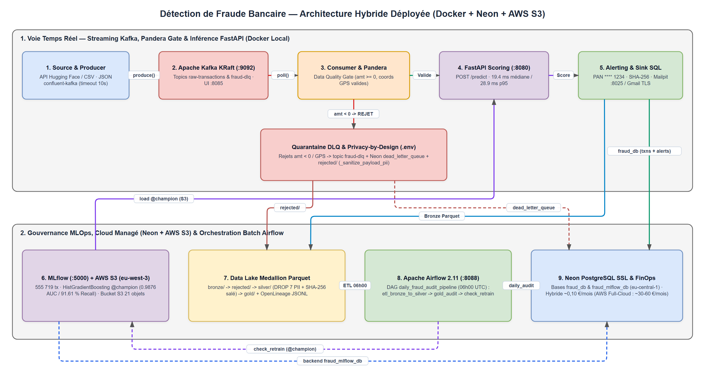

# 🛡️ Pipeline Détection de Fraude Bancaire — Architecture Technique (Bloc 3)

> Architecture hybride déployée en **Docker local** (`Kafka KRaft`, `Pandera`, `FastAPI`, `MLflow`, `Mailpit`, `Airflow 2.11`) et **Cloud managé** (`Neon PostgreSQL SSL`, `AWS S3 eu-west-3`, `Gmail TLS`).

---

## 🟩 1. Contexte & Besoins

Une plateforme de paiement doit bloquer la fraude en **moins de 100 ms** tout en assurant la qualité des données, la conformité légale (**PCI-DSS**, **RGPD**) et l'audit quotidien.

| Besoin | Réponse déployée | Résultat vérifié |
| :--- | :--- | :--- |
| **Scoring temps réel** | **Kafka KRaft** + **FastAPI** | `19.4 ms` médiane (`28.9 ms` p95) |
| **Gouvernance MLOps** | **MLflow** + **Neon** + **AWS S3 (`eu-west-3`)** | Benchmark 3 modèles (`@champion` / `@challenger`) |
| **Qualité & Quarantaine** | **Pandera** (`DataFrameSchema`) | Rejets isolés dans `fraud-dlq` + `rejected/` |
| **Sécurité PCI-DSS & RGPD** | Masquage PAN + **SHA-256 salé** + DROP PII | Zéro donnée bancaire ou PII en clair |
| **Batch & Traçabilité** | **Airflow 2.11** + Parquet **Medallion** | Audit 06h00 UTC + **OpenLineage JSONL** |

---

## 🟦 2. Schéma d'architecture déployée

> Source éditable Draw.io : [`_sources/schema_architecture_infrastructure_fraud.drawio`](schema_architecture_infrastructure_fraud.drawio)

Lecture de la chaîne :

1. **Haut (Temps réel Docker)** : le flux entre par `Kafka KRaft`, passe la barrière `Pandera`, est scoré par `FastAPI` puis déclenche l'alerte SMTP et l'écriture SQL.
2. **Centre (Quarantaine)** : toute donnée invalide (`amt < 0`, GPS aberrant) part sans bloquer le pipeline vers `fraud-dlq`, `dead_letter_queue` et `rejected/`.
3. **Bas (MLOps & Batch)** : `MLflow + S3` fournit le modèle `@champion`, le Data Lake `Medallion` nettoie les données et `Airflow` orchestre l'audit quotidien vers `Neon PostgreSQL`.

---

## 🟨 3. Stack déployée (Docker Compose + Cloud Managé)

| Service | Rôle principal | Emplacement / Port |
| :--- | :--- | :--- |
| **Neon PostgreSQL (SSL)** | Bases isolées `fraud_db` (txns, alertes, DLQ, audit) et `fraud_mlflow_db` | Cloud `eu-central-1` |
| **Amazon S3** | Stockage réel des artefacts MLflow (`21` objets, bucket dédié) | Cloud `eu-west-3` |
| **Kafka KRaft + Kafka UI** | Bus événementiel sans ZooKeeper (`raw-transactions`, `fraud-dlq`) | Docker `:9092` / `:8085` |
| **MLflow Server** | Tracking & Model Registry (`@champion` / `@challenger`) | Docker `:5000` |
| **FastAPI Scoring** | Inférence `POST /predict` + rechargement à chaud `POST /reload-model` | Docker `:8080` |
| **Mailpit / Gmail TLS** | Alerting e-mail temps réel via `smtplib` (bascule via `.env`) | Docker `:1025/:8025` ou `:587` |
| **Apache Airflow 2.11** | Orchestration `LocalExecutor` du DAG matinal `daily_fraud_audit_pipeline` | Docker `:8088` |

*(Un service local `minio` reste configuré dans `docker-compose.yml` en secours hors-ligne.)*

---

## 🟧 4. Modèle Machine Learning & Benchmark

Toutes les étapes (entraînement, API et ETL Silver) utilisent la même fonction [`prepare_features()`](../../01_train/features.py) pour supprimer tout *training-serving skew*.

- **Jeu de données** : `fraudTest.csv` (`555 719` transactions, dont `2 145` fraudes = `0.39 %`, split stratifié 80/20).
- **5 variables extraites** : `amt` (montant), `distance_km` (Haversine client–marchand), `city_pop` (densité urbaine), `hour` (heure UTC), `age` (calculé depuis `dob`).
- **Pipeline anti-fuite** : `StandardScaler()` encapsulé dans `sklearn.pipeline.Pipeline`.

| Modèle testé | Version | Alias | ROC-AUC | PR-AUC | Recall | Précision | F1-Score | Fit |
| :--- | :---: | :---: | :---: | :---: | :---: | :---: | :---: | :---: |
| **HistGradientBoosting_Balanced** | **v3** | **`@champion`** | **0.9876** | 0.6093 | **91.61 %** | 0.0833 | 0.1527 | 7.48 s |
| **RandomForest_Balanced** | **v2** | **`@challenger`** | 0.9836 | **0.6156** | 82.05 % | **0.2051** | **0.3282** | 12.51 s |
| **LogisticRegression_Balanced** | v1 | — | 0.8236 | 0.1418 | 74.13 % | 0.0589 | 0.1091 | 0.33 s |

> **Pourquoi `HistGradientBoosting_Balanced` en `@champion` ?** En fraude bancaire, rater une fraude coûte bien plus cher qu'une vérification 3-D Secure : son **Recall de 91.61 %** et son **ROC-AUC de 0.9876** protègent mieux les encaissements.

**Performances mesurées (modèle chargé depuis AWS S3, 20 requêtes `/predict`) :**

- **Latence HTTP** : `15.5 ms` min · **`19.4 ms` médiane** · **`28.9 ms` p95** · `32.5 ms` max *(large marge sous le SLA `< 100 ms`)*.
- **Artefact fallback** : `fraud_model.joblib` (`357.0 Ko`).

---

## 🟥 5. Qualité Pandera, Sécurité PCI-DSS / RGPD & Data Lake Medallion

### 🔐 Barrières sécurité & confidentialité

- **Secrets isolés (`.env`)** : aucune clé AWS, URL Neon, mot de passe Gmail ou `SECRET_SALT` dans le code ni sur Git (`.env` dans `.gitignore`).
- **PCI-DSS v4.0** : `mask_credit_card()` masque chaque numéro en `**** **** **** 1234` avant toute écriture SQL, Parquet, log ou e-mail.
- **Pseudonymisation RGPD** : `pseudonymize_name()` applique un **SHA-256 salé** (`sha256(SECRET_SALT:nom)`).
- **Minimisation stricte** : les 7 PII directs (`cc_num`, `first`, `last`, `street`, `dob`, `job`, `zip`) sont **supprimés physiquement** dans Silver et avant toute écriture en DLQ (`_sanitize_payload_pii()`).

### 🗂️ Parcours des données (Streaming → Medallion → OpenLineage)

| Zone / Étape | Ce qui s'y passe | Sortie & gouvernance |
| :--- | :--- | :--- |
| **1. Kafka `raw-transactions`** | Réception JSON depuis HF Live / CSV | Tampon anti-rafales (timeout `10 s`) |
| **2. Pandera Quality Gate** | Contrôle `amt >= 0` et GPS valides | Flux valide ou rejet `fraud-dlq` + `rejected/` |
| **3. FastAPI + Alerting** | Score fraude `@champion` (S3) + SMTP | `Neon fraud_db` (`transactions`, `fraud_alerts`) + `bronze/` |
| **4. Silver Parquet** | Déduplication + hash salé + **DROP 7 PII** | Zéro PII nominatif |
| **5. Gold Parquet** | Features ML, agrégats et suivi du Data Drift | `Neon daily_audit_summary` + `openlineage_events.jsonl` |

---

## 🟪 6. Orchestration Airflow & FinOps

### 🔄 DAG matinal `daily_fraud_audit_pipeline` (06h00 UTC)

1. **`etl_bronze_to_silver`** : lit la partition du jour, valide en batch avec Pandera, isole `rejected/` et supprime les 7 PII.
2. **`gold_audit_and_drift`** : produit la couche Gold, met à jour `daily_audit_summary` dans Neon, génère le rapport Markdown matinal et journalise l'événement **OpenLineage**.
3. **`check_retrain_trigger`** : vérifie la dérive statistique des montants et interroge l'alias `@champion` sur MLflow `:5000`.

### 💶 Gouvernance FinOps

| Mode | Services utilisés | Coût mensuel estimé |
| :--- | :--- | :--- |
| **Hybride actif (Déployé)** | Compute Docker local + **Neon Free Tier** + **AWS S3 (`eu-west-3`)** | **< 0,10 € / mois** |
| **Cible Full-Cloud AWS** | EC2 `t3.small` / App Runner + RDS `db.t4g.micro` (ou Neon) + S3 + SES | **~30 à 60 € / mois** *(alertes AWS Budgets à 80 %, tags `Project=FraudBloc3`)* |

---

## 🧠 7. Résumé global

| Couche | Technologies déployées | Rôle clé |
| :--- | :--- | :--- |
| **Streaming & API** | `Kafka KRaft` · `Pandera` · `FastAPI` | Filtrer et scorer chaque paiement en `19.4 ms` |
| **MLOps & Stockage** | `MLflow` · `AWS S3` · `Neon PostgreSQL` | Versionner `@champion` et persister sans perte |
| **Batch & Gouvernance** | `Airflow 2.11` · `Parquet Medallion` · `OpenLineage` | Auditer, anonymiser (PCI-DSS/RGPD) et détecter le drift |

---

## 🏁 8. Conclusion

Le pipeline Bloc 3 est **entièrement déployé et démontré de bout en bout** :

- **Temps réel fiable** : `19.4 ms` de latence médiane avec isolation automatique des données corrompues en DLQ.
- **Sécurité native** : zéro PAN ni PII en clair (masquage, SHA-256 salé, suppression physique en Silver/DLQ).
- **Industrialisation hybride maîtrisée** : stack reproductible par `docker-compose.yml` et basculable vers le Cloud AWS via `.env` à coût quasi nul (`< 0,10 €/mois`).
