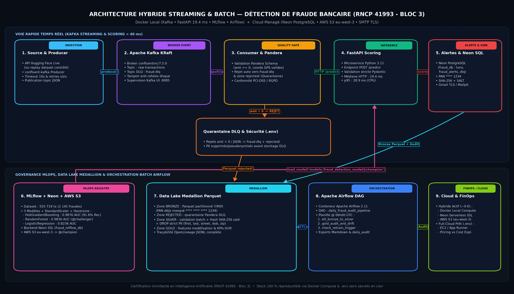

# 🚨 Détection de Fraude Bancaire Temps Réel & Batch — Bloc 3 (RNCP 41993)



Architecture hybride **Streaming Temps Réel (`confluent-kafka` + FastAPI)** et **Orchestration Batch Medallion (`Apache Airflow 2.11` + `Apache Parquet`)**, alignée sur la **topologie Cloud/Locale Session 3** : services compute/streaming en **Docker local**, bases opérationnelles & MLOps sur **Neon PostgreSQL (`fraud_db`, `fraud_mlflow_db`)**, artefacts modèles sur **AWS S3 (`eu-west-3`, bucket `fraud-bloc3-mlflow-rncp41993-chris`)**, contrôle qualité **Pandera Data Quality Gate**, conformité **PCI-DSS / RGPD** et traçabilité **OpenLineage**.

* **🎥 Démonstration vidéo complète (3 min 54 s — Google Drive) :** https://drive.google.com/file/d/1nUORFhIksV191HoE_yuvA1I3GrJLSQNe/view?usp=sharing

---

## 🎯 Objectifs & Conformité Référentiel (RNCP 41993 - Bloc 3)

1. **Streaming & Contre-pression (`C2`, `C3`) :** Ingestion continue depuis l'API temps réel Hugging Face (ou replay contrôlé) via `confluent-kafka` sur broker **Apache Kafka KRaft**.
2. **Qualité des Données & Quarantaine (`C4`, `C5`) :** Validation stricte en entrée par **Pandera `DataFrameSchema`** (`amt >= 0`, coordonnées GPS valides). Tout payload corrompu est dérivé sans interruption vers le topic Kafka `fraud-dlq`, la table SQL `dead_letter_queue` sur **Neon** et la zone Data Lake `data_lake/rejected/`.
3. **MLOps & Inférence Sub-40 ms (`C1`, `C2`, `C4`) :** Benchmark multi-modèles encapsulant `StandardScaler()` + classifieurs dans MLflow (backend **Neon `fraud_mlflow_db`** + artefacts **AWS S3 `eu-west-3`**), promotion automatique `@champion` / `@challenger`, et microservice FastAPI (`POST /predict`, `/reload-model`).
4. **Conformité PCI-DSS & RGPD Privacy-by-Design :**
   - Masquage strict du PAN (`**** **** **** 1234`).
   - Pseudonymisation irréversible **SHA-256 salé** (`SECRET_SALT` injecté via `.env`, jamais versionné dans Git).
   - Suppression stricte des PII directs (`first`, `last`, `street`, `dob`, `job`, `zip`) lors de l'ETL Bronze → Silver et avant stockage quarantaine DLQ.
5. **Alerting Temps Réel & Audit Batch Matinal (`C4`, `C5`) :** Notification instantanée via `smtplib` (**Gmail SMTP TLS `587`** ou fallback local **Mailpit**), persistance opérationnelle dans **Neon PostgreSQL (`fraud_db`)**, Data Lake Medallion partitionné `year=/month=/day=`, traçabilité **OpenLineage**, et DAG **Apache Airflow** à 3 tâches.

---

## 🏗️ Stack Hybride : Docker Local + Cloud Managé (Neon & AWS S3)

| Composant | Localisation / Conteneur | Port / Région | Rôle Actif dans l'Architecture |
| :--- | :--- | :--- | :--- |
| **Neon PostgreSQL (Cloud)** | Serveur managé SSL | `eu-central-1` | Bases isolées **`fraud_db`** (transactions, alertes, DLQ, audits) et **`fraud_mlflow_db`** (registry MLflow) |
| **Amazon S3 (Cloud)** | Bucket dédié `fraud-bloc3-mlflow-rncp41993-chris` | `eu-west-3` | Stockage objet réel des modèles et artefacts MLflow (`21` objets enregistrés) |
| **MLflow Server (Docker)** | `fraud-mlflow-server` (`elkristobal59/mlflow:latest`) | `:5000` | Tracking & Registry local connecté à Neon `fraud_mlflow_db` et AWS S3 |
| **Kafka KRaft + UI (Docker)** | `kafka-fraud-broker` & `kafka-fraud-ui` | `:9092` / `:8085` | Broker événementiel sans ZooKeeper (`raw-transactions` & `fraud-dlq`) + console |
| **FastAPI Scoring (Docker)** | `fraud-scoring-api` | `:8080` | Microservice d'inférence chargeant `models:/fraud_detection_model@champion` depuis MLflow + S3 |
| **Apache Airflow (Docker)** | `fraud-airflow` + PostgreSQL scheduler local | `:8088` / `:5432` | Orchestration du DAG matinal `daily_fraud_audit_pipeline` (06h00 UTC) |
| **Alerting SMTP** | `fraud-mailpit` (dev) ou **Gmail TLS** (`smtp.gmail.com`) | `:1025/:8025` ou `:587` | Envoi temps réel via `smtplib` (bascule Gmail par `.env`) |
| **Fallback MinIO (Docker)** | `fraud-minio` (`9000` / `9001`) | Optionnel offline | Conservé en secours 100 % hors-ligne si `MLFLOW_S3_ENDPOINT_URL` est défini |

---

## 📊 Résultats Modélisation MLflow (`fraudTest.csv` — 555 719 transactions réelles)

Benchmark réalisé sur l'intégralité du jeu de données (`555 719` transactions dont `2 145` fraudes, soit `0.39 %`), avec split stratifié 80/20, **Haversine + StandardScaler + features temporelles** partagées dans [`01_train/features.py`](01_train/features.py) :

| Modèle (`Pipeline`) | Version MLflow | Alias | ROC-AUC | PR-AUC | Recall | Précision | F1-Score | Temps Fit |
| :--- | :---: | :---: | :---: | :---: | :---: | :---: | :---: | :---: |
| **HistGradientBoostingClassifier** (`balanced`) | **v3** | **`@champion`** | **0.9876** | 0.6093 | **91.61 %** | 0.0833 | 0.1527 | 7.48 s |
| **RandomForestClassifier** (`balanced`) | **v2** | **`@challenger`** | 0.9836 | **0.6156** | 82.05 % | **0.2051** | **0.3282** | 12.51 s |
| **LogisticRegression** (`balanced`) | v1 | — | 0.8236 | 0.1418 | 74.13 % | 0.0589 | 0.1091 | 0.33 s |

* **Taille de l'artefact sérialisé de secours (`01_train/fraud_model.joblib`) :** `357.0 Ko`
* **Latence HTTP mesurée sur `POST http://localhost:8080/predict` (20 requêtes après préchauffe, modèle chargé depuis MLflow + AWS S3) :**
  * Minimum : `15.5 ms` | Médiane : **`19.4 ms`** | p95 : **`28.9 ms`** | Maximum : `32.5 ms`

---

## 🧬 Data Lineage & Traçabilité OpenLineage

| Étape | Source | Transformation / Contrôle | Cible | Gouvernance |
| :--- | :--- | :--- | :--- | :--- |
| **1. Ingestion** | API Hugging Face / CSV | Émission JSON + création topic | Kafka `raw-transactions` | Retry & timeout 10 s |
| **2. Quality Gate** | Topic `raw-transactions` | Validation Pandera `TRANSACTION_SCHEMA` | Flux valide ou `fraud-dlq` | Rejets tracés avec motif exact |
| **3. Quarantaine** | `fraud-dlq` | `_sanitize_payload_pii()` (PAN + PII) | Neon `dead_letter_queue` + `rejected/` | Zéro PII en clair dans la DLQ |
| **4. Inférence** | Flux valide | `prepare_features()` + `@champion` (S3) | FastAPI `/predict` (HTTP 200 / 422) | Rechargement à chaud `/reload-model` |
| **5. Operational Sink** | Réponse `/predict` | Mask PAN `**** 1234` + SHA-256 + SMTP | Neon `transactions`, `fraud_alerts`, SMTP, `bronze/` | Idempotence sur `trans_num` |
| **6. Medallion Silver** | `bronze/` Parquet | Batch Pandera + hash salé + **DROP PII** | `silver/` (`clean_transactions_silver.parquet`) | Aucune colonne PII directe |
| **7. Gold & OpenLineage** | `silver/` + Neon | Features ML + Drift + Audit + OpenLineage | `gold/`, `daily_audit_summary`, `lineage/` | Événement JSONL `COMPLETE` |

Événements conformes **OpenLineage v1** journalisés dans `data_lake/lineage/openlineage_events.jsonl` à chaque exécution Airflow ou `run_daily_audit.py`.

---

## 💶 FinOps : Architecture Hybride Active vs Cible Full-Cloud (`eu-west-3`)

La topologie hybride active (**Docker local + Neon Free Tier + AWS S3 `eu-west-3`**) reste quasiment gratuite (`< 0.10 €/mois` uniquement pour les quelques Mo stockés sur S3) tout en offrant une transition transparente vers une mise en production complète :

| Composant Architecture | Mode Hybride Actif (Soutenance) | Cible Full-Cloud AWS (`eu-west-3` Paris) | Coût Mensuel Estimé (AWS Calculator Dev/PME) |
| :--- | :--- | :--- | :--- |
| **Compute API, Kafka, MLflow, Airflow** | Conteneurs Docker locaux | AWS App Runner / EC2 `t3.small` + MSK / ECS | ~15 € – 40 € / mois selon débit |
| **Bases PostgreSQL** | **Neon PostgreSQL Serverless (Actif)** (`fraud_db`, `fraud_mlflow_db`) | Neon Free Tier / Pro ou AWS RDS `db.t4g.micro` | **0 €** (Neon Free) à ~13 € / mois (RDS) |
| **Stockage Artefacts & Lake** | **Amazon S3 `eu-west-3` (Actif)** (`fraud-bloc3-mlflow-rncp41993-chris`) | Amazon S3 Standard + Intelligent-Tiering / Glacier | **< 1 € / mois** (< 10 Go) |
| **Alerting SMTP** | **Mailpit Docker** (tests sans spam) / **Gmail TLS `587`** | Gmail Workspace ou AWS SES (`62 000` e-mails inclus EC2) | **~0 € / mois** |

* **Prévisionnel (`AWS Pricing Calculator`) :** Permet de modéliser le coût mensuel cible (~29 € – 60 €/mois hors trafic massif) avant le déploiement en jouant sur le dimensionnement instance, S3 Intelligent-Tiering et les politiques de cycle de vie Parquet.
* **Contrôle Réel (`AWS Cost Explorer` & `AWS Budgets`) :** Suivi quotidien de la dérive budgétaire par tags (`Project=FraudBloc3`, `Env=Prod`, `Owner=AIA-RNCP41993`) et déclenchement automatique d'alertes à 80 % du plafond mensuel.

---

## ⚙️ Installation & Démonstration Pas à Pas

### 1. Configuration sécurisée (`.env`)
Copier le modèle sans secrets vers `.env` (ignoré par Git via `.gitignore`) :
```powershell
cd 03_BLOC_3_PIPELINE_FRAUD_DETECTION
Copy-Item .env.example .env
# Renseigner <VOTRE_SECRET_SALT_MIN_32_CHARS> et vos accès S3 / Neon / SMTP si mode Cloud
```

### 2. Démarrage complet de l'infrastructure Docker Compose
```powershell
docker compose up -d --build
```
*(Build autonome éventuel du microservice seul : `docker build -f 02_api/Dockerfile -t fraud-scoring-api:latest .`)*

### 3. Entraînement Multi-Modèles & Promotion MLflow `@champion`
```powershell
python 01_train/train_model.py
# Recharger à chaud le modèle @champion dans l'API FastAPI :
Invoke-RestMethod -Method Post http://localhost:8080/reload-model
```

### 4. Exécution du Pipeline End-to-End (Streaming Kafka -> Pandera -> API -> SMTP -> Neon -> Medallion)
```powershell
python run_full_pipeline_demo.py
```

### 5. Test direct du DAG Apache Airflow (`daily_fraud_audit_pipeline`)
```powershell
docker exec fraud-airflow airflow dags list
docker exec fraud-airflow airflow dags test daily_fraud_audit_pipeline 2026-11-12
```

### Accès aux Interfaces Web & Cloud
* **MLflow UI (Backend Neon `fraud_mlflow_db` + Artefacts AWS S3) :** `http://localhost:5000`
* **API FastAPI Swagger :** `http://localhost:8080/docs`
* **Kafka UI :** `http://localhost:8085`
* **Mailpit (E-mails d'alertes en mode test local) :** `http://localhost:8025` *(remplacé par Gmail TLS `smtp.gmail.com:587` dès configuration de `SMTP_USER` / `SMTP_PASSWORD` dans `.env`)*
* **Apache Airflow UI :** `http://localhost:8088`
* **AWS S3 (`eu-west-3`) :** `s3://fraud-bloc3-mlflow-rncp41993-chris/`
* **Console MinIO (fallback local offline) :** `http://localhost:9001`

---

## 📦 Livrables Officiels (`03_BLOC_3_PIPELINE_FRAUD_DETECTION/LIVRABLES/`)
* `schema_architecture_infrastructure_fraud.png` — Schéma d'architecture complet Streaming, MLflow S3, Medallion & Airflow
* `ARCHITECTURE_PIPELINE_FRAUD_BLOC3.pptx` & `.pdf` — Support de soutenance orale (5 min pitch)
* `RAPPORT_ARCHITECTURE_TECHNIQUE_PIPELINE.pdf` — Dossier d'architecture technique, sécurité, Data Lineage & FinOps
* `LIEN_DEMO_VIDEO.pdf` & `demo fraud detection christopher gilleron.mp4` — Guide et démonstration vidéo complète : https://drive.google.com/file/d/1nUORFhIksV191HoE_yuvA1I3GrJLSQNe/view?usp=sharing
* `Fraud_Detection_Livrables_Bloc3.zip` — Archive consolidée prête pour dépôt certification RNCP 41993
