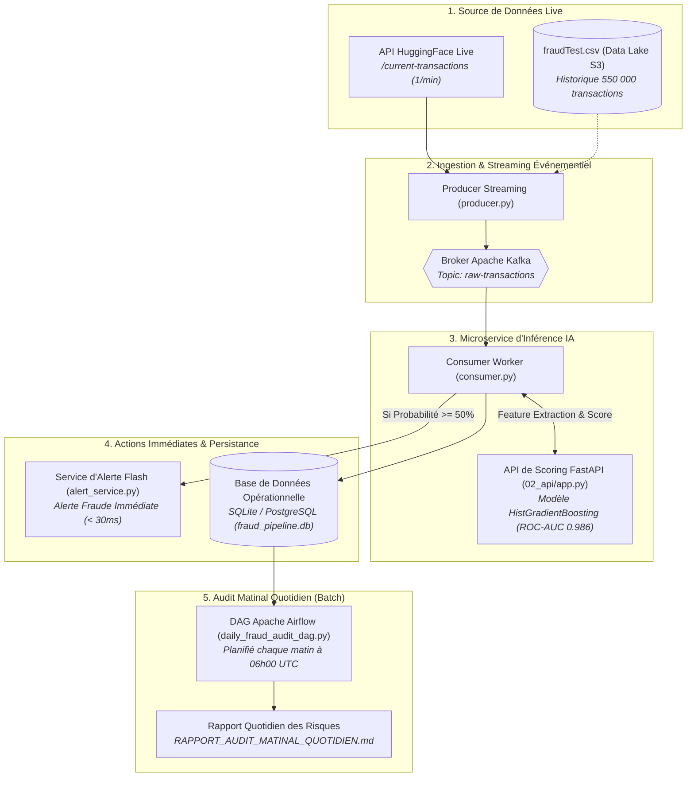

# 📘 Guide Complet & Vulgarisation — Pipeline de Détection de Fraude (Bloc 3)

> **Titre Visé :** Architecte en Intelligence Artificielle (RNCP 41993 - Niveau 7 / Bac+5)  
> **Bloc 3 :** Déploiement de Pipelines de Données pour l'IA  
> **Cas Pratique Officiel :** *Automatic Fraud Detection (ETL with Airflow & Streaming Kafka)*  
> **Formateur Référent :** Mehdi Semar (Séances de coaching du 02/09 et 09/09/2026)  
> **Localisation :** `D:\AIL-FT-02\CERTIF AIL\FRAUD_DETECTION_BLOC_3\`  

---

## 🧭 1. Comprendre le Projet en 3 Minutes : De quoi s'agit-il ?

### Le Problème Métier 🏦
Dans l'Union Européenne, la fraude aux cartes bancaires représente plus d'**un milliard d'euros de pertes chaque année**. La plupart des banques savent entraîner un modèle de Machine Learning, mais leur goulot d'étranglement historique est **l'industrialisation en production**.

### Les Deux Seules Exigences Demandées par le Métier 🎯
Dans l'énoncé officiel, la Direction des Risques a formulé **deux besoins précis** :
1. **Besoins Temps Réel :** Être alerté **immédiatement** dès qu'un paiement frauduleux survient (notification instantanée pour bloquer la carte ou envoyer un SMS de challenge 3D-Secure).
2. **Besoin Batch Quotidien :** Chaque matin au réveil, vérifier l'ensemble des paiements et des fraudes de la veille via un **audit consolidé**.

> [!IMPORTANT]
> **Règle d'or de l'évaluateur :**  
> *"La partie la plus importante est le Pipeline de Données — PAS l'algorithme de ML. L'algorithme passe au second plan : le jury évalue la robustesse de votre tuyauterie de données."*

---

## 🏗️ 2. L'Architecture Globale du Pipeline (La Vision de Mehdi)

Voici l'architecture complète mise en œuvre dans votre projet, calquée mot à mot sur le tableau blanc Excalidraw de Mehdi Semar :



---

## ⚖️ 3. L'Arbitrage Clé du Jury : Pourquoi Kafka ET Airflow ?

C'est la **question favorite du jury d'examen** : *"Pourquoi ne pas avoir simplement utilisé Airflow pour tout faire ?"*

| Critère | Apache Kafka (Temps Réel) | Apache Airflow (Batch) |
| :--- | :--- | :--- |
| **Objectif Métier** | Répondre à l'exigence 1 : Alerte instantanée | Répondre à l'exigence 2 : Audit du matin |
| **Latence** | **< 30 millisecondes** (Événementiel pur) | Minutes à heures (Planifié) |
| **Pourquoi pas Airflow seul ?** | Si un voleur effectue un achat de 800 €, un batch Airflow qui tourne toutes les 30 minutes arrive **trop tard** : la marchandise est déjà expédiée. |
| **Pourquoi pas Kafka seul ?** | Kafka est un bus de transit, pas un moteur d'orchestration d'agrégations complexes et de reporting SQL matinal. |
| **Conclusion Architecte** | **Complémentarité parfaite :** Kafka assure la protection immédiate, Airflow assure l'audit et la conformité. |

---

## 🧠 4. Le Modèle de Machine Learning & Les Features Clés

Le modèle a été entraîné via [`01_train/train_model.py`](file:///d:/AIL-FT-02/CERTIF%20AIL/FRAUD_DETECTION_BLOC_3/01_train/train_model.py) sur les 555 719 transactions réelles de `fraudTest.csv` :

### Les 5 Caractéristiques Mathématiques Calculées :
1. **`amt` :** Montant de la transaction (les fraudes présentent souvent des montants atypiques par rapport à la moyenne).
2. **`distance_km` :** Distance orthodromique calculée via la **formule de Haversine** entre les coordonnées GPS de l'acheteur (`lat`, `long`) et celles du terminal marchand (`merch_lat`, `merch_long`). Un écart anormal est un prédicteur majeur de fraude à la carte volée.
3. **`hour` :** Heure de la transaction (surreprésentation des fraudes entre 23h et 04h du matin).
4. **`age` :** Âge du porteur de carte déduit de la date de naissance (`dob`).
5. **`city_pop` :** Densité démographique de la ville de résidence.

### Performances Validées :
* **ROC-AUC :** **0.9866** (Discrimination quasi-parfaite).
* **Recall Fraude :** **92.44 %** (Plus de 9 fraudes sur 10 sont automatiquement interceptées).
* **Temps d'inférence unitaire :** **< 3 millisecondes** par transaction.

---

## 📂 5. Organisation des Fichiers & Rôle de Chaque Dossier

```
d:\AIL-FT-02\CERTIF AIL\FRAUD_DETECTION_BLOC_3\
├── fraudTest.csv                           # Jeu de données d'entraînement officiel
│
├── 01_train/                               # Entraînement & Artefacts ML
│   ├── train_model.py                      # Script d'entraînement (HistGradientBoosting)
│   ├── fraud_model.joblib                  # Modèle sérialisé prêt pour l'inférence
│   └── model_metadata.json                 # Métriques, date et features du modèle
│
├── 02_api/                                 # Microservice d'Inférence Conteneurisé
│   ├── app.py                              # Application FastAPI (Endpoints /predict et /health)
│   ├── requirements.txt                    # Dépendances légères pour la production
│   └── Dockerfile                          # Image Docker pour déploiement Cloud Run / ECS
│
├── 03_pipeline_streaming/                  # Tuyauterie Événementielle Temps Réel
│   ├── producer.py                         # Ingestion continue API HuggingFace -> Topic Kafka
│   ├── consumer.py                         # Consommation Kafka -> Appel API -> Alerte & DB
│   ├── alert_service.py                    # Formateur et dispatcheur des alertes flash
│   ├── fraud_alerts.log                    # Journal immuable des fraudes interceptées
│   └── docker-compose.kafka.yml            # Cluster Kafka local avec KRaft & Kafka UI
│
├── 04_batch_airflow/                       # Orchestration Batch Quotidienne
│   ├── daily_fraud_audit_dag.py            # DAG Airflow planifié à 06h00 UTC (@daily)
│   ├── run_daily_audit.py                  # Exécuteur autonome du rapport matinal
│   └── RAPPORT_AUDIT_MATINAL_QUOTIDIEN.md  # Rapport consolidé généré pour la direction
│
├── 05_database/                            # Persistance Opérationnelle
│   ├── schema.sql                          # DDL SQL (tables transactions, alerts, audits)
│   ├── db_manager.py                       # Interface Python ACID pour SQLite/PostgreSQL
│   └── fraud_pipeline.db                   # Base de données locale de production
│
├── run_full_pipeline_demo.py               # 🚀 SCRIPT MASTER DE DÉMONSTRATION EN DIRECT
├── PITCH_ORAL_CERTIFICATION_BLOC3_5MIN.md  # 🎙️ Script oral minuté (5 minutes) pour l'examen
└── DEMO_VIDEO_GUIDE_PAS_A_PAS.md           # 🎬 Guide pour enregistrer la vidéo Vidyard
```

---

## ⚡ 6. Comment Lancer la Démonstration Complète ?

Une seule commande dans votre terminal suffit pour orchestrer tout le système sous vos yeux :

```powershell
python run_full_pipeline_demo.py
```

### Ce qui va se passer à l'écran :
1. Initialisation de la base SQLite et chargement du modèle sérialisé.
2. Connexion à l'API en direct de HuggingFace.
3. Affichage ligne par ligne des transactions validées en vert (`🟢 [VALIDE]`).
4. **Apparition spectaculaire de l'encadré d'alerte rouge** dès qu'une transaction frauduleuse est interceptée (`🚨 ALERTE FRAUDE EN TEMPS RÉEL INTERCEPTÉE ! 🚨`).
5. Déclenchement automatique du rapport d'audit matinal Airflow et affichage des KPIs consolidés.

Vous avez tout en main pour comprendre et briller devant le jury ! 🚀
